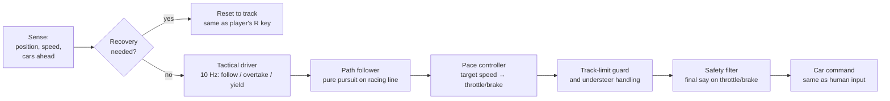

# Adaptive F1 Racing Game: Progress Report

**Branch:** `ai_driving` (commit `4489e56`) · **Engine:** Unity 6 (URP), C#, with Python tools · **Date:** 25 Nov 2026

> Each `---` line starts a new slide, so Marp, reveal.js or Slidev can turn this file into a deck.

---

## 1. Project goal

An F1-inspired racing game whose AI opponents give a **fair, suitable challenge**.

> **Adapt the challenge, not the rules.**

- The human and the AI drive **the same car physics** and follow **the same race rules**.
- Difficulty changes only how hard the AI pushes (its pace settings). It never changes engine power, grip or collisions.
- The player picks the difficulty and it stays **locked for the whole race**, with no hidden catch-up.
- The game must stay fully playable **without any learned model**. A rule-based driver comes first, and learned prediction is added on top later.

---

## 2. Status at a glance

| Area | Status |
|---|---|
| Car physics (shared by human and AI) | ✅ Done, retuned with real F1 numbers |
| Monza-style track and one-click rebuild | ✅ Done |
| Rule-based AI driver | ✅ Done, still being tuned from play-tests |
| Race flow: menu, lights, 3 laps, results | ✅ Done |
| Simplified F1 rules | ✅ Done |
| 1–22 AI opponents, AI-only spectator race | ✅ Done (not play-tested yet) |
| Debug logs and Python log analysis | ✅ Done |
| Season, practice and qualifying weekend | ⏳ Not started |
| Player profile and difficulty recommendation | ⏳ Not started |
| Learned prediction and MPC planner | ⏳ Not started (Python service stub only) |
| Offline training and ONNX export | ⏳ Not started |

---

## 3. What has been built

### Track
- A **Monza-style circuit**, scaled to about 2.5 km:
  - Main straight.
  - Rettifilo chicane.
  - Curva Grande.
  - Roggia.
  - Lesmo 1–2.
  - Ascari.
  - Parabolica.
- The track is **18 m wide** with **14 m of asphalt run-off** before the barrier. Kerbs, grandstands and the pit building are generated from the track spline.
- One editor click (**Tools > Track > Rebuild Monza Track**) rebuilds the track surface, scenery and pit.
- The start line sits at 170 m along the main straight, so a **23-car grid** fits on the straight.

### Car physics (one spec for every car)
| Quantity | Value |
|---|---|
| Mass (with driver) | 800 kg |
| Engine | 750 kW, power-limited drive: force = min(traction, P / v) |
| Aero | drag CdA 1.4, downforce ClA 4.8; DRS cuts drag by 10% |
| Assists | ABS, traction control, anti-roll bars |
| Predicted performance | 0–100 km/h in about 2.3 s, top speed about 343 km/h (about 355 km/h with DRS) |

The predicted figures come from a simple point-mass calculation. They have not been measured in-game yet.

---

## 4. Race and simplified F1 rules

Every rule applies **identically to the human and the AI**.

- **Start:**
  - Five red lights, then lights out.
  - Moving more than 0.5 m before lights out is a **jump start**: +5 s.
  - AI reaction times are 0.20–0.35 s, similar to a human.
- **Track limits:**
  - All four wheels past the white line counts as a strike, and that lap time is deleted.
  - Strike 3 brings the black-and-white flag.
  - Strike 4 and every strike after it adds +5 s.
- **DRS:**
  - Two zones.
  - Allowed from lap 2, when a car is less than 1.0 s behind the car ahead at the detection line.
  - Braking closes the flap.
- **Flags:**
  - Blue: a car about to be lapped moves off the line and eases off.
  - Yellow: a stopped car is ahead.
- **Results:** points 25-18-15-12-10-8-6-4-2-1. The fastest lap is shown in purple and earns no point.
- **Menu options:**
  - Difficulty (Easy, Normal, Hard, Expert).
  - **1–22 AI opponents.**
  - **Human driver on/off**, for an AI-only race.
  - Ghost cars (no car-to-car contact).
  - Fun mode.

---

## 5. AI driving approach: overview

The AI is a **conventional, rule-based driver**. There is no end-to-end machine learning.
It controls the car through **the same command interface as the human** (steer, throttle, brake, DRS), so it cannot cheat the physics.

All of these steps run on every physics tick, except tactics, which run 10 times per second.

---

## 6. AI driving: racing line and speed plan

**1. Racing line (computed once per track)**
- The line is stored as a sideways offset from the centre line every 5 m.
- An optimiser **minimises bending energy** (the sum of curvature² × distance). It applies smooth bumps at coarse and then fine scales, so the line straightens out corners within the legal width.
- A wider corner radius means a higher corner speed with the same grip. This is how a good driver is fast.
- The line stays **2 m inside the white lines**, to respect track limits.

**2. Speed profile**
- **Corner speed** from grip plus downforce:
  `v = sqrt(μg / (|k| − μ·c_aero/m))`, where k is the curvature of the line.
- It is also capped by the steering lock the car really has at that speed (the same steering limit the player has).
- A **backward braking pass** moves each braking point earlier so the car reaches the corner speed in time.
- Result: a target speed at every point on the lap.

---

## 7. AI driving: control loop

| Component | Job |
|---|---|
| **Path follower** | *Pure pursuit*: it steers toward a point 8–45 m ahead on the line. The distance grows with speed. |
| **Pace controller** | Turns the gap between current and target speed into throttle and brake. It looks 0.3 s ahead for braking. |
| **Tactical driver** | Chooses a lane: left, centre or right. It overtakes when a car close ahead blocks the line, and it keeps that choice for at least 2 s so the car doesn't flicker between lanes. |
| **Understeer handling** | If the path needs more steering lock than the car has, it lifts first and then brakes lightly, like a human would. |
| **Track-limit guard** *(new)* | Within 0.5 m of the white line and still drifting out, the car aims back inside, lifts, and remembers the corner. |
| **Safety filter** | Runs last and overrides everything else. It brakes for a car close ahead. It reduces contact but does not guarantee none. |
| **Recovery** | Resets the car to the track when it is stuck, facing the wrong way, at the barrier, or flipped. It uses the same reset as the player's R key. |

---

## 8. AI driving: in-race learning and difficulty

**Corner memory (a per-car skill, not a physics change)**
- When the car understeers, crashes or reaches the white line, it lowers its planned speed around that corner by 1–4%.
- Each clean lap it recovers a little, so it keeps probing back toward the fastest plan.
- This feels like a driver learning the track. It does **not** change the car.

**Difficulty**
The menu choice is locked for the race and maps to **pace settings only**:

| Setting | Slowest | Fastest |
|---|---|---|
| Grip use (share of the grip model) | 0.8 | 1.7 |
| Planned braking (m/s²) | 11 | 16 |
| Throttle cap | 0.9 | 1.0 |

- Each AI driver has a **stable identity**: a name, livery, a small skill offset and an aggression value. It never changes during a race and there's no "revenge" pace after being overtaken.
- These values are **provisional defaults** from play-tests, not validated optima.

---

## 9. How the AI was tuned: evidence from play-tests

Each race writes `race_log.txt`, `ai_telemetry.csv` (4 rows per second per car) and `player_input.csv`. These logs drove every change:

| Race | Problem seen in the logs | Change made |
|---|---|---|
| 1 | Pile-up at a hairpin on lap 1 | Lower planned braking; no inside lane in slow corners |
| 2 | AI corner speeds about half the player's | Shared minimum-energy racing line; higher grip use |
| 3 | 9 stuck resets at one corner (understeer into the wall) | Understeer lift and brake; per-corner memory |
| 4 | AI 6–7 s/lap slower, over-cautious | Lift before braking; trims recover each lap |
| 7 | Barrier hits on a fast bend at 80+ m/s | Corner speed capped by the steering lock available |
| 9 | 439 track-limit strikes in one race | Wider margins plus the **track-limit guard** *(awaiting re-test)* |

**Design decision:** an earlier version let the AI **copy the player's driving**. It was removed so the AI decides by itself, from its own line and its own mistakes.

---

## 10. Changes in this round

- **Track:** a new Monza-style layout, wider, with run-off.
- **Physics:** a retune with real F1 numbers. The hard-coded values became shared settings, and a self-check confirms every car is identical.
- **Rules:** a new rules module covering track limits, DRS, jump start, flags and points.
- **AI:**
  - Player-copy removed.
  - Stays inside the white lines.
  - Yields under blue flags.
  - Human-like reaction times at the start.
- **Field size:** 1–22 opponents, with 22 fictional drivers and liveries, and an AI-only mode.
- **Clean-up:** dead code, unused builders and empty folders deleted.
- **Checks:** an editor self-check covers physics parity, rules, track geometry and grid placement. There are 7 Python unit tests.

---

## 11. Verification so far

**Verified**
- The C# compiles with 0 errors.
- The Python tests pass (7 of 7).
- Several play-tests were analysed from the logs (table on slide 9).

**Not verified yet**
- Whether the track-limit guard removes the AI strikes. This needs a play-test.
- Frame rate with 23 cars.
- The real 0–100 km/h time, top speed and braking g, measured from `player_input.csv`.
- Difficulty vs. lap time on the new track (re-run *Tools > AI > Run Pace Sweep*).

---

## 12. What still needs development

1. **Weekend flow:**
   - FP1, FP2 and FP3, each optional: skip one, skip the rest, or end early.
   - A pre-qualifying review, one qualifying run, then the race.
   - Saves at each session boundary.
2. **Pre-qualifying recommendation:**
   - The game suggests a difficulty and shows the evidence behind it.
   - The player accepts it or picks their own.
   - It is **locked from qualifying through the race**.
3. **Player profile:**
   - Pace estimates from clean laps only.
   - Crashes and incidents kept as separate statistics.
   - Skipped sessions count as missing data, never as poor skill.
4. **Difficulty approval chain:**
   - The model predicts and the planner proposes a change.
   - A separate **fairness check** approves it, and a **single component** applies it.
   - Every decision is logged.
5. **Learned prediction:**
   - A model predicting player pace: about 3 small neural networks averaged.
   - A calibrated AI-pace lookup.
   - A short-horizon **MPC planner** that picks a sustainable challenge, never a forced winner.
6. **Adaptive training mode:**
   - Opt-in live adaptation, separate from competitive races.
   - Small, rate-limited steps.
7. **Offline tooling:**
   - Synthetic player bots and a dataset pipeline.
   - PyTorch training, release checks, ONNX export, and parity tests between Python and Unity.
8. **Automated acceptance tests** for all of the above.

---

## 13. Summary

- A **playable F1-style race** with fair, shared physics and rules, running entirely without learned models.
- A **transparent rule-based AI**: an optimised racing line, physics-based speed planning, pure-pursuit steering, tactics, safety and recovery. It is tuned from logged evidence.
- **Next:** the weekend structure and the evidence-based difficulty recommendation. After that, learned prediction and the MPC planner, all behind a fairness check.
