# Adaptive Racing Opponent — Architecture v1.2

This revision adds an action-conditioned tactical world model while preserving the v1.1 game and challenge-adaptation architecture. The v1.2 decisions below supersede the inherited specification wherever they differ. In particular, references to a conventional driver mean conventional **low-level control**, not necessarily scripted tactical selection. The inherited specification follows for full gameplay, contracts, policy, and deployment details.

## 1. Two predictive loops

| Loop | Decision | Model | Authority |
|---|---|---|---|
| Tactical, inside D04 | Hold line, defend, attack, switch back, or back out | Short-horizon two-car dynamics and possible player responses conditioned on an AI maneuver | Proposes a maneuver only; existing controllers and D08 execute or override it |
| Challenge, A04–A11 and M01–M03 | Recommend a suitable difficulty | Player pace, calibrated AI pace, and lap-level progression | FairnessGovernor and DifficultyConfigApplier remain the only approval/application path |

Both loops use observable evidence, but do not share objectives. The tactical loop races for position within fixed permissions; the challenge loop selects suitable pace, not a target winner. The competitive difficulty lock does not freeze tactical choices. Qualifying review still cannot write competitive difficulty. Neither loop modifies grip, power, collision rules, timing, or classifications. Deep RL is not a dependency.

## 2. D04 internal responsibilities

| ID | Responsibility | Contract |
|---|---|---|
| D04a DuelContextBuilder | Select one relevant nearby player and build a timestamped track-relative snapshot | Recent observed progress, lateral offset, heading, speed, overlap, curvature, track widths, current commitment; no future or private player inputs |
| D04b PlayerStyleEstimator | Summarize context-specific tendencies from observed encounters | Style distribution, support count, and uncertainty; neutral prior when new; no inference from skipped practice |
| D04c ManeuverGenerator | Generate structured candidates consistent with current commitment | Maneuver type, target path or lane and pace request within the approved configuration; initial set HoldLine, DefendInside, BackOut |
| D04d TacticalWorldModel | Predict plausible outcomes for each candidate | `Predict(context, style, candidate)` returns time-indexed joint trajectories, weights or confidence, and support flags |
| D04e TacticalPlanner | Reject infeasible maneuvers and rank the rest | `ManeuverPlan` with path, speed target, expiry, abort conditions and reason, or conservative fallback |

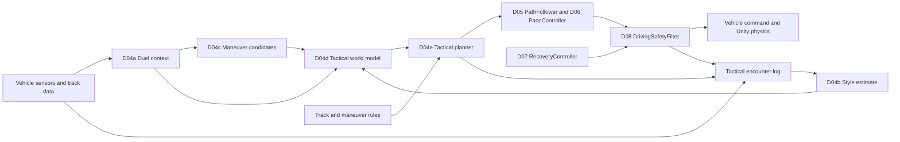

### Model and decision policy

- Start with geometric paths, simple track-relative motion, and weighted player-response templates. Roll out several branches, e.g. holds line, continues an inside attempt, or switches back. Use roughly two seconds as an initial benchmark setting, not a guaranteed sufficient horizon.
- Rank viable plans by clean position gain or retention, exit pace, risk and switching cost. Reject invalid braking, track-boundary violations, insufficient room under overlap rules, and late attacks that only work if the player yields. A late inside attack must have a feasible abort path.
- Replan on a lower-frequency tactical tick and retain a committed legal maneuver to avoid oscillation. D05/D06/D08 run on the existing physics tick. Safety overrides and recovery take priority. On stale, unsupported, or invalid forecasts, keep a still-safe plan or use the scripted safe fallback. In unmodeled multi-car traffic, keep the conservative driving policy rather than pretending the duel model covers the field.
- Keep `ScriptedTacticalDriver` as a selectable baseline. Also support non-interactive lookahead and action-conditioned lookahead behind the same D04 interface. Optional learned response probabilities replace templates only after validation; the waypoint, recovery, and safety layers stay unchanged.

### Logging, calibration and release

Log encounter ID, snapshots, tactical variant, generated candidates, forecast weights, rejected reasons, proposal, executed maneuver, overrides, and outcome. Learn from actual observed encounters, not imagined branches. Tag tactical logs and M02 calibration with driver version, track, vehicle configuration and supported traffic conditions. Prototype sweeps can use the scripted driver; regenerate or revalidate final M02 tables for the selected driver, especially in traffic. Do not reuse stale calibration as if it were validated.

Compare tactical variants at fixed difficulty with identical physics and safety logic. Compare challenge planners with the same tactical driver. Assess clean passes/defenses, contact, off-track events, aborts/overrides and human fairness feedback separately from lap-level pace-band error and lock compliance.

---

## Inherited v1.1 specification

The following sections remain in force except where explicitly updated above.

# Adaptive Racing Opponent — Final Unity Game and AI Architecture

**Version:** 1.1  
**Status:** Implementation specification  
**Platform:** Unity and C#  
**Offline training:** Python and PyTorch  
**Core:** Conventional driving + hybrid pace prediction + constrained model-predictive planning  
**Organization:** Part A — Unity Game Architecture; Part B — AI Architecture

> The system selects a suitable challenge, not a predetermined race outcome. Practice is optional. Qualifying is reviewed as evidence, but does not automatically change the accepted competitive race difficulty.


## Executive decisions

| Concern | Decision |
|---|---|
| Season | Configurable 19–22 weekends; FP1, FP2, FP3, one qualifying run, race |
| Practice | Optional independently; all remaining FP sessions can be skipped |
| Driving | Path following, speed planning, tactical lane selection, independent safety filtering |
| Challenge adaptation | Between sessions by default; bounded live adjustment only in opt-in training mode |
| Competitive lock | Player confirms main difficulty before qualifying; the same setting applies to qualifying and race |
| Qualifying review | Classify grid, update single-lap evidence, check predictions, inform future recommendations |
| Prediction | Calibrated AI pace + compact player predictor + explicit progression equations |
| Planner | Short-horizon constrained MPC; no RL policy required in the core |
| Human-data scarcity | Priors, missing-data handling, synthetic testing, conservative personalization, held-out human validation |
| Fairness | Shared physical limits, stable identities, incident protection, consent, authoritative governor |
| Learning releases | Runtime profile updates; offline validation before deploying new network weights |
| Initial scope | Three circuits, one player, three to five AI cars |

Numeric settings are provisional engineering defaults to validate, not proven global optima. This is an F1-inspired format, not an implementation of official sporting regulations.

## Diagram and implementation notes

All diagrams are Mermaid; no image files are required. A Mermaid-capable viewer is needed for rendering. Tables and prose remain authoritative if the viewer cannot render a diagram. Diagrams are design specifications, not measured results.

---

# Part A — Unity Game Architecture

## A1. Ownership and system boundary

The Unity game must run correctly with learned models disabled.

| Game owns | AI owns |
|---|---|
| Physics, track boundaries, timing, classification | Driving commands within physical limits |
| Session lifecycle, skip permissions, saves | Pace estimation and challenge proposals |
| Adaptation permissions and lock state | Prediction and uncertainty |
| Approval and application of difficulty changes | Search over supported candidates |
| Consent, UI, telemetry, recovery rules | Decision diagnostics |

The planner cannot modify Rigidbody state, engine specifications, tyre grip, classification, session locks, or championship results.

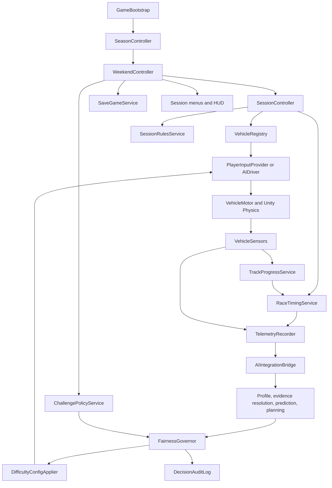

## A2. Assemblies and dependency rules

| Assembly | Responsibilities |
|---|---|
| Racing.Contracts | IDs, immutable snapshots, enums, interface contracts |
| Racing.Vehicle | VehicleMotor, VehicleSensors, player input |
| Racing.Track | Geometry, limits, checkpoints, progress |
| Racing.Gameplay | Season/weekend/session controllers, timing, rules |
| Racing.Policy | ChallengePolicyService, FairnessGovernor, approval records |
| Racing.AI.Driving | PathFollower, PaceController, TacticalDriver, safety filter |
| Racing.AI.Adaptation | Evidence resolver, profile estimator, predictors, MPC, qualifying review |
| Racing.Integration | SnapshotBuilder, bridge, configuration applier |
| Racing.Telemetry | Aggregation, buffered writing, schema validation |
| Racing.UI | Menus, explanations, HUD, explicit user commands |
| Racing.Evaluation | Batch runners, scenario assertions |
| Racing.Editor | Track baking and calibration tooling; editor-only |

Dependency rules:

- Contracts do not depend on gameplay or AI implementations.
- Physics does not reference the adaptation model.
- The optimizer cannot bypass Racing.Policy.
- UI reads state through interfaces and submits commands; it is not authoritative state.
- Integration connects gameplay, policy, and AI.
- Use a composition root and explicit service references rather than hidden global state.

## A3. Scenes, assets, and lifetimes

### Scenes

- Bootstrap: persistent services, saves, model registry, logging.
- MainMenu: season, input, challenge mode, consent.
- RaceShell: timing, session controller, HUD, spawning.
- Track_<id>: additively loaded circuit geometry and runtime assets.
- EvaluationRunner: automated scenarios without human UI.

### Data assets

| Asset | Fields |
|---|---|
| SeasonDefinition | Ordered weekends, points rules |
| WeekendDefinition | Track, session rules, participants, race laps |
| SessionRules | Type, duration/laps, grid rules, qualifying invalid-lap fallback |
| ChallengePolicy | Mode, skip permissions, adaptation windows, limits, cooldown |
| VehicleSpecification | Shared physical capabilities and handling |
| OpponentIdentity | Stable relative skill, style, consistency |
| TrackDefinition | Authoring spline, boundaries, checkpoints, sectors |
| TrackRuntimeData | Baked distances, tangent, curvature, widths, reference pace |
| ModelManifest | Model/schema versions, normalization, support domain, file hash |
| EvaluationScenario | Tracks, brains, bot families, seeds, repeat count |

ScriptableObjects hold authoring defaults. Copy to per-session/per-vehicle runtime state; never mutate a shared skill asset to change one car.

### Lifetimes

SeasonController owns calendar and championship. WeekendController owns progression and accepted difficulty. SessionController owns an active session. Vehicle state lasts for its spawn. PlayerProfileStore persists across weekends. ModelRegistry owns approved model versions and rollback references.

## A4. Vehicle, track, and timing

### Vehicle command pipeline

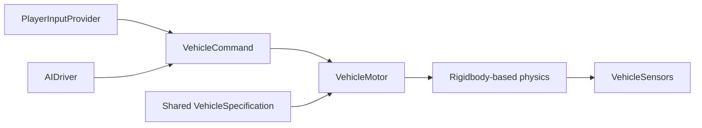

VehicleCommand: steering [-1,1], throttle [0,1], brake [0,1]. Reject non-finite inputs and clamp ranges. Begin with a tunable arcade Rigidbody model unless detailed wheel behavior is a central requirement.

### Track processing

TrackBakeTool converts a spline and boundaries into sampled centerline geometry: position, tangent, curvature, cumulative distance, drivable width, checkpoints, sectors, reference speed. Track descriptors include length, straight fraction, and corner distribution.

New circuits require geometry, baking, reference calibration, and validation—not simply a new track ID.

### Progress and rules

TrackProgressService maintains completed laps, validated distance along the lap, last checkpoint, sector, and lap validity.

\[
p=nL+s
\]

RaceTimingService owns checkpoint crossing timestamps, valid sector/lap times, classification, and timestamped gap measurements. Compare time at common timing boundaries; do not use distance/current-speed as the authoritative gap when cars stop or occupy different corners.

SessionRulesService enforces track limits, valid laps, grid placement, completion, points, and recovery penalties for human and AI alike.

Prototype exclusions: weather, pit strategy, tyre compounds, fuel strategy, safety cars. Add them only when runtime and forecast states explicitly support them.

## A5. Skippable practice: user operations

| Action | Allowed scope | Result |
|---|---|---|
| Start practice | Any pending FP session | Run selected practice |
| End practice early | Active FP session | Finalize observed data and advance |
| Skip this practice | Pending FP session | Mark skipped and advance |
| Skip remaining practice | Pending or active FP stage | Finalize active practice if needed; skip later FP sessions; open review |
| Continue to qualifying | Pre-qualifying review | Confirm difficulty, lock, begin qualifying |

Qualifying and race are not included in the practice skip operation. Session skipping never creates fabricated player or AI practice observations.

### Session status

```csharp
public enum SessionStatus
{
    NotStarted,
    InProgress,
    Completed,
    EndedEarly,
    Skipped
}
```

```text
SessionRecord
- SessionId, SessionType, Status
- StartedAt, EndedAt, ElapsedTime
- CompletedLapCount, ValidLapCount, ValidSectorCount
- EndReason
- TelemetryCommitId
```

- A never-started practice that is bypassed becomes Skipped.
- A started practice that the player exits becomes EndedEarly, even with zero completed laps.
- Normal expiry becomes Completed.
- A skip request is idempotent: repeated clicks cannot advance twice.

## A6. Weekend state machine

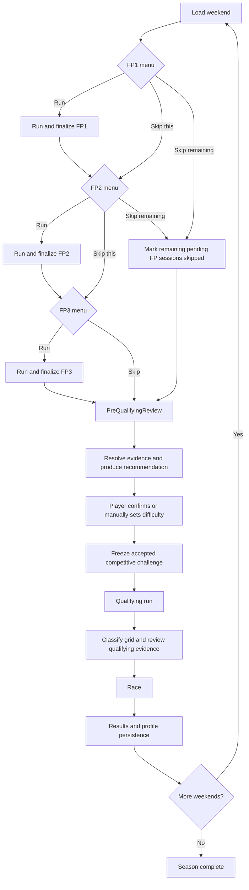

Ending an active FP session follows its normal finalization path; choosing skip remaining then marks only later pending sessions skipped.

## A7. Partial-session finalization and persistence

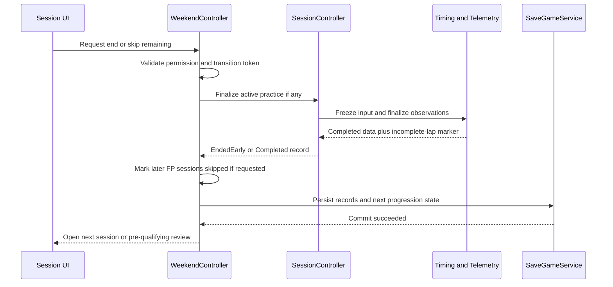

Rules:

- Retain completed valid sectors and laps.
- An incomplete lap remains incomplete; never scale a partial lap into a fabricated full time.
- Completed clean sectors can inform sector-level estimation, but are not independent full-lap samples.
- Skipped observations use missingness/status flags, never zero-second times.
- Deduplicate sector evidence when its completed lap arrives; do not count it twice.
- Save accepted difficulty, skipped/ended statuses, telemetry commit, and next state coherently before advancement.
- If persistence fails, offer retry without applying a second transition.

For a first implementation, save at session boundaries and restart an interrupted active session on reload. Preserve previously committed data with observation IDs so it cannot be counted twice. Exact mid-session physics restoration is out of scope unless explicitly implemented.

## A8. Pre-qualifying review and mode policy

PreQualifyingReview always runs, even after all FP sessions are skipped. It displays evidence source, recommendation, and uncertainty explanation. Manual selection remains available.

| Mode | Qualifying | Race |
|---|---|---|
| Competitive season — default | Accepted main difficulty locked | Same accepted setting; no hidden catch-up |
| Adaptive training — opt-in | Accepted starting setting locked | Explicitly permitted small changes at approved boundaries |

Example when no practice was completed:

> Practice was skipped. This weekend will use your selected difficulty. Qualifying helps improve your profile; it will not automatically change competitive race difficulty.

No data is a valid state. Do not force practice, punish skipping, or claim high calibration confidence without evidence.

## A9. Qualifying review lifecycle

A qualifying run consists of an out-lap, one flying lap, and optional in-lap, or a documented simplified timed-lap start. Invalid/no-time results follow the configured grid fallback.

After qualifying:

1. Validate observations and classify the grid through authoritative race rules.
2. Compare actual qualifying performance with its prediction.
3. Update single-lap evidence, confidence, and mismatch diagnostics.
4. Keep the competitive difficulty lock unchanged.
5. Persist evidence for subsequent race analysis and future recommendations.

If the player explicitly requests recalibration after qualifying, treat it as a separate restart-weekend/repeat-qualifying workflow. Do not silently retain a grid earned under one challenge while changing only the competitive race difficulty.

## A10. Fairness enforcement

FairnessGovernor is independent of the optimizer. DifficultyConfigApplier accepts only approved, unexpired configurations and rechecks session/policy versions.

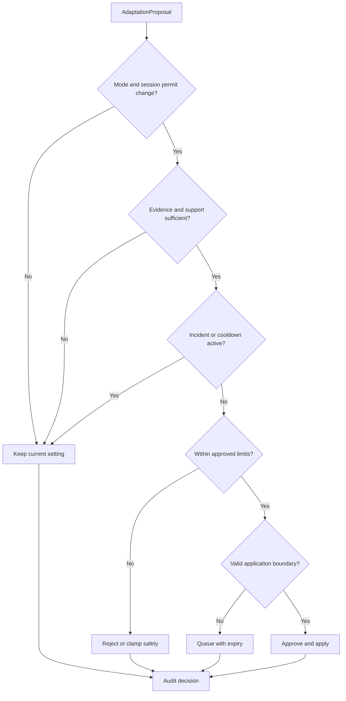

Queued practice proposals cannot become race writes after a lock. Revalidate all queued proposals.

Provisional live-mode defaults: difficulty step at most 0.02, cooldown two completed player laps, freeze in the final two laps, incident hold until at least one subsequent clean lap. Short races may allow no live changes. Validate effects in seconds of pace, not just normalized difficulty units.

Never alter engine power, grip, collision rules, or classification for balancing. Preserve stable opponent personalities and allow earned leads to remain.

## A11. Scheduling, telemetry, and privacy

| Trigger | Work |
|---|---|
| Physics tick | Sensors, path following, safety, motor commands |
| Lower-frequency tactical tick | Lane/overtaking decisions |
| Sector/lap event | Aggregate quality-labeled observations |
| Practice finalization | Commit data, update profile, advance |
| Pre-qualifying review | Evidence resolution, recommendation, confirmation |
| Qualifying end | Grid classification and qualifying review |
| Permitted player-lap boundary | Optional live training proposal |
| Weekend end | Persist profile, results, opt-in export queue |
| Offline release process | Train, validate, approve weights |

Do not trigger live adaptation independently on every opponent lap. Use a designated player-lap event and timestamped snapshots.

Keep model work outside the physics critical path. If inference misses its deadline, retain the last approved configuration. Fixed-step physics and independent seeded random streams improve reproducibility; they do not guarantee identical Unity physics across devices.

Telemetry records include:

- RunManifest: build, track/config hashes, seeds, schema/model versions.
- SessionRecord: statuses, end reasons, evidence totals.
- SectorSummary/LapSummary: raw times, reference times, validity, traffic, incidents, masks.
- DifficultyApplication: actual applied setting and approval ID.
- QualifyingReviewRecord: residual, quality decision, profile update, no-change lock outcome.
- DecisionAuditRecord: old/proposed/approved values, evidence, uncertainty, reason.

Retain raw times plus normalization references. Log applied actions, not just proposals. Mark mixed-action laps. Buffer disk writes. Keep opted-in research exports separate from local saves, pseudonymize identifiers, provide profile reset/deletion, and never upload by default.

## A12. Game acceptance tests

| Scenario | Required outcome |
|---|---|
| Skip FP1 | FP2 available; FP1 recorded Skipped |
| Skip all practice | Pre-qualifying review opens with fallback evidence |
| End FP2 after two valid laps | Those observations retained; status EndedEarly |
| Exit mid-lap | No fabricated lap time |
| Duplicate skip request | One transition only |
| Reload after skip | Status and next state preserved |
| No practice and no profile | Manual/default setting available |
| Invalid qualifying lap | Documented no-time classification |
| Qualifying starts | Competitive lock enforced |
| Strong qualifying performance | Profile reviewed; no silent race boost |
| Stale queued action | Rejected after session/version change |
| Model unavailable | Usable fixed/rule-based opponent |
| Player earns a lead | Competitive mode does not erase it |
| Invalid checkpoint traversal | Lap cannot count as valid |

---

# Part B — AI Architecture

## B1. Responsibilities and data flow

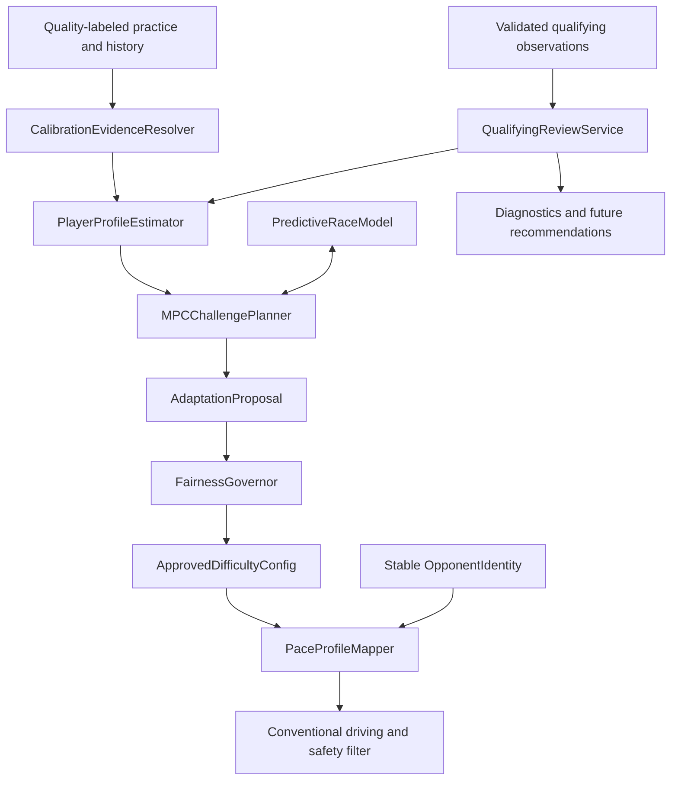

The model predicts; the planner proposes; the governor authorizes; the driving system executes. Qualifying review has no direct configuration-application path.

## B2. Contracts and components

| Contract | Producer | Consumer |
|---|---|---|
| VehicleObservation | Sensors | Driver and safety filter |
| SectorSummary/LapSummary | Timing/telemetry | Quality gate and estimator |
| CalibrationDecision | Evidence resolver and calibrator | Pre-qualifying review UI |
| PlayerProfileSnapshot | Estimator | Planner and predictor |
| ChallengeContext | Session/policy service | Planner and governor |
| AdaptationProposal | Planner | Governor |
| ApprovedDifficultyConfig | Governor | Applier |
| QualifyingReviewResult | QualifyingReviewService | Profile store and diagnostics |


Use explicit units, validity flags, timestamps, and version IDs. Snapshot inputs should not permit mutation of authoritative game state.

## B3. Conventional driving

| Component | Responsibility |
|---|---|
| TacticalDriver | Follow, overtake, yield; stable decisions with hysteresis |
| PathFollower | Speed-dependent look-ahead steering within valid lane |
| PaceController | Target speed and braking look-ahead |
| DrivingSafetyFilter | Restrict commands for unsafe clearance/track margins |
| RecoveryController | Stuck/off-track recovery under shared rules |

Starting corner-speed rule:

\[
v=\min\left(v_{max},\sqrt{a_{lat}/\max(|\kappa|,\epsilon)}\right)
\]

Use a backward braking pass so upcoming corner targets are reachable. Safety overrides tactics and pace but does not guarantee collision-free physics.

Do not lower difficulty by deliberate collisions, steering noise, or late-braking failures. Adapt target pace utilization, acceleration demand, and braking conservatism within validated limits.

## B4. Identity and pace mapping

\[
d_i=\operatorname{clamp}(d_{session}+\delta_i,0,1)
\]

Relative skill offset delta_i and style stay stable. Shared session calibration preserves identity; avoid saturating many drivers at the same bound.

PaceProfileMapper converts difficulty to controller settings through calibrated lookup/interpolation. Measure expected pace using automated Unity sweeps. Difficulty must not secretly increase physical capabilities. A linear difficulty increment is not necessarily a linear lap-time increment.

## B5. Player profile and evidence quality

```text
PlayerProfile
  SingleLapPace
    qualifyingEstimate, uncertainty, evidenceCount
  SustainableRacePace
    normalizedEstimate, uncertainty, effectiveSampleCount
  Consistency
    cleanLapVariation, sectorVariation
  Incidents
    collisionRate, offTrackRate
  TrackFamiliarity
    cleanLapsOnTrack, recentImprovement
  Personalization
    globalCorrection, trackCorrection
  Preferences
    mode, acceptedDifficulty, adaptationConsent
```

Label observations clean, traffic-limited, incident-affected, invalid, incomplete, or missing. Preserve source session and observation age.

Normalize using versioned track references:

\[
r=T_{player}/T_{reference}
\]

For sparse observations, shrink toward a prior:

\[
\hat{s}=\frac{n_{eff}}{n_{eff}+k}s_{recent}+\frac{k}{n_{eff}+k}s_{prior}
\]

n_eff reflects quality and dependence; sectors from the same lap are not independent laps. Tune k on held-out data.

Do not discard incident information entirely: exclude it from clean-pace estimation while retaining separate incident statistics. Monitor whether filtering leaves an unrepresentatively favorable subset.

## B6. CalibrationEvidenceResolver: optional practice and cold start

The resolver runs regardless of how many FP sessions exist. It must not require FP3 specifically.

| Available evidence | Resolution |
|---|---|
| Enough current-track clean practice | Blend with prior; current observations receive appropriate weight |
| Limited practice/clean sectors | Use partial evidence with uncertainty and shrinkage |
| No practice; same-track history | Use historical profile with age/configuration checks |
| No track history; global history | Conservative transfer using track features |
| No usable history | Manual difficulty or clearly labeled default |

CalibrationDecision contains recommended difficulty, evidence source, quality-weighted count, uncertainty, cold-start flag, and confirmation requirement.

Important separation:

- The resolver identifies evidence and fallback.
- The estimator builds the profile.
- The rule baseline or planner produces the recommendation.
- The player accepts or overrides it.
- The governor authorizes application.

Skipped sessions remain missing—not zero pace, poor skill, or invented samples. Missingness masks and ages must be consistent in Python and Unity.

## B7. QualifyingReviewService

### Inputs

- Validated lap and sector observations.
- Quality labels and session conditions.
- Practice/history-based prediction and uncertainty.
- Accepted difficulty and authoritative policy.

### Outputs

```text
QualifyingReviewResult
- ObservationAccepted
- SingleLapPaceUpdate
- PredictionResidual
- ConfidenceUpdate
- PracticeQualifyingMismatch
- FutureReviewRecommendation
- LockPreserved
```

### Decision rules

| Qualifying observation | Response |
|---|---|
| Valid and consistent with forecast | Add single-lap evidence |
| Valid and much faster | Flag possible improvement/underestimated potential |
| Traffic-limited slow lap | Preserve traffic label; avoid clean-pace downgrade |
| Spin, collision, invalid lap | Apply session rules; no automatic difficulty decrease |
| No practice | Treat as initial single-lap evidence with substantial uncertainty |
| Large unexplained mismatch | Record diagnostic and future review request |

Do not let one lap overwrite several clean practice laps automatically. Single-lap potential and sustained consistency are different quantities. If the game has no tyre/fuel differences, do not import an arbitrary real-world qualifying-to-race time offset.

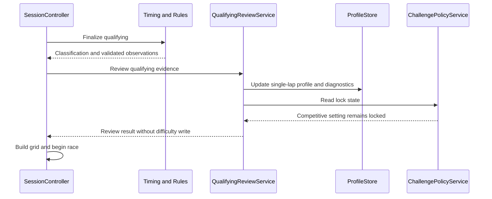

Qualifying may improve later race prediction, but the normal competitive race uses the accepted setting. Future recommendations may use the new evidence. With no practice, the game remains usable at the manual/default difficulty rather than performing an unannounced recalibration.

## B8. PredictiveRaceModel: hybrid dynamics

This is a compact model of pace/progression, not a visual model of the entire world.

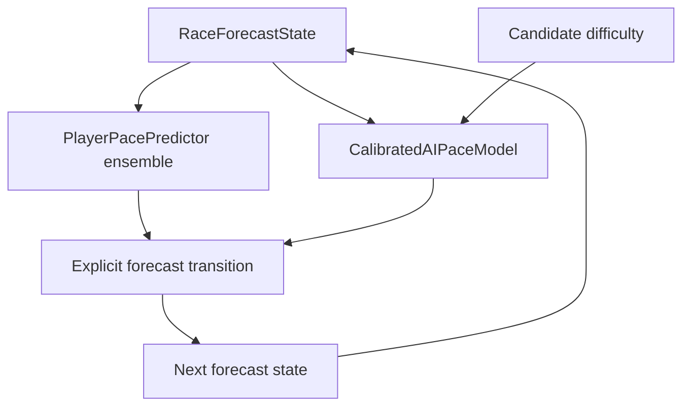

### CalibratedAIPaceModel

Inputs: track features, difficulty, identity, supported simulation conditions. Outputs: expected AI lap time, variation, support flag. Calibrate clean-air and representative traffic cases; otherwise increase uncertainty or fall back outside supported conditions.

### PlayerPacePredictor

Inputs: recent three to five observations with masks/age, clean pace/trend/variation, track features/familiarity, personal correction, supported traffic context, and session type.

Outputs: expected clean pace and predictive variance. Maintain separate qualifying/sustained estimates or explicit session conditioning. Do not assume opponent difficulty causally improves human pace without evidence.

Initial architecture: ensemble of three small MLPs, each with two hidden layers of approximately 64 units. Use bootstrap sampling at player/run level. This is a starting configuration to benchmark, not an optimum claim.

### Explicit transition

At matched timing boundaries define:

\[
g_t=\text{player cumulative time}-\text{AI cumulative time}
\]

\[
g_{t+1}=g_t+\hat{T}_{player,t+1}-\hat{T}_{AI,t+1}
\]

Positive gap means the player is behind. Unmatched wall-clock snapshots must be adapted or marked unavailable.

| Forecast variable | Update |
|---|---|
| Gap/cumulative time | Analytical transition |
| Predicted pace history | Append prediction with a predicted-value mask |
| Evidence count | Never increase using imagined observations |
| Familiarity | Hold fixed over the short horizon unless modeled |
| Remaining laps | Decrement |
| Difficulty | Candidate action |
| Uncertainty | Propagate ensemble trajectories |
| Traffic/incidents | Restrict horizon or widen uncertainty when not modeled |

Validate multi-step behavior, not only one-step error. Do not add an imagined collision-risk cost unless an actual supported risk model exists.

## B9. MPC planning and baseline behavior

The default objective matches sustainable pace, not a forced finish gap:

\[
J=\sum_{h=1}^{H}\left[w_p\operatorname{dist}(\hat{T}_{AI,h}-\hat{T}_{player,h},\mathcal{B}_{pace})^2+w_d(d_h-d_{h-1})^2+w_uU_h\right]
\]

B_pace is a relaxed/matched/challenging pace band. U_h is normalized uncertainty. Initially H=3, shortened as necessary. Tune weights with units and scale in mind.

Candidate generation:

- Between-session: coarse difficulty grid, fixed-setting forecast per candidate; optional supported local refinement.
- Competitive qualifying/race: hold accepted setting; no action-changing optimization.
- Live training: current minus step, current, current plus step at permitted decision points.

Three actions over three decision points give at most 27 sequences before pruning. Cooldowns mean decision points are not necessarily consecutive laps.

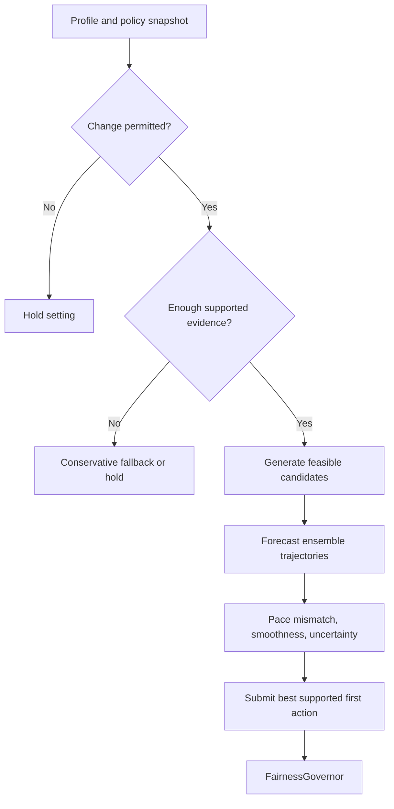

Baselines: fixed manual setting; clean-pace lookup calibration; predictive MPC. Optional supervised/PPO/distilled methods must use the same policy limits. RL is not required for this small infrequent action problem, but is not categorically inferior in other settings.

## B10. Limited human data: training and personalization

| Source | Purpose | Limitation |
|---|---|---|
| AI pace sweeps | Calibrate difficulty-to-pace mapping | No evidence of human enjoyment |
| Diverse scripted players | Coverage, robustness, missing-data tests | Not a complete human model |
| Opt-in humans | Transfer validation and subjective fairness | Small samples have limited generality |

Vary bot cornering, braking, acceleration, consistency, improvement rate, traffic sensitivity, correlated mistakes, and pace drift. Use more than one implementation where feasible; hold out whole bot families.

Include data scenarios with full practice, only FP1, only FP3, partial practice, all practice skipped, unfamiliar tracks, and invalid qualifying. Simulate missing-observation patterns without turning hidden data into player evidence.

Personalize cheaply:

\[
\hat{T}_{human}=\hat{T}_{base}+b_{player,track}
\]

Shrink sparse track corrections toward a global correction; bound updates and use quality labels. Profiles update locally; network weights do not train in the race. If learned transfer is weak, retain a transparent rolling estimator.

Use ensemble disagreement, feature/calibration support, and recent residual/interval checks together. Agreement is not proof of correctness. Fall back conservatively when evidence is weak.

Split datasets by human player, full run/weekend, track, and bot family. Keep adjacent laps together. Fit normalization only on training data. Preserve held-out human evaluation data outside fine-tuning.

## B11. Training, deployment, and release gates

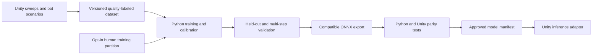

Pin Unity/package versions and validate ONNX operator support early. The manifest defines tensor order/shape, units, clipping, masks, normalization, output interpretation, model hash, and supported configuration domain.

Benchmark CPU inference first; measure latency percentiles, allocation, and memory on the target machine. Warm up and reuse buffers. No fixed millisecond promise is assumed.

Promote weights only after import/schema tests, Python-Unity parity, acceptable held-out and multi-step errors, uncertainty checks, fairness/safety regression tests, and measured resource budgets. Keep rollback weights and a non-neural fallback. New weekend data queues an offline candidate process, not automatic model replacement.

## B12. AI fairness and failure behavior

- No future human inputs, intended controls, target winner, or desired championship standings.
- No retaliatory speed increase after overtaking.
- No gap-forcing reward or artificial overtake incentive.
- Single incidents update incident statistics without immediate skill downgrade.
- Qualifying review cannot authorize difficulty writes.
- Skipping practice cannot count as evidence of low skill.
- Competitive leads remain earned.

Reason codes include LOCKED_COMPETITIVE_SESSION, INSUFFICIENT_CLEAN_DATA, PRACTICE_SKIPPED_USING_PRIOR, RECENT_INCIDENT, OUTSIDE_CALIBRATION_SUPPORT, PREDICTION_UNCERTAIN, STALE_POLICY_VERSION, QUALIFYING_REVIEW_LOCK_PRESERVED, and NO_SUPPORTED_CANDIDATE.

Invalid model outputs, unavailable inference, deadline misses, unsupported inputs, or empty candidate sets produce a logged hold/fallback, not an uncontrolled change.

## B13. Evaluation and acceptance gates

Compare competitive and live-training modes separately. Use matched scenario settings, repeated runs, separate random streams, and uncertainty intervals. Do not claim enjoyment from simulated closeness alone.

| Area | Metrics |
|---|---|
| Calibration | Pace mismatch to selected band, monotonic mapping quality |
| Prediction | One-step/multi-step error; interval coverage |
| Cold start | Zero/few/many clean observations; practice skip patterns |
| Qualifying review | Single-lap residuals, invalid-lap handling, lock preservation |
| Stability | Difficulty changes, actual pace shifts, fallback rate |
| Safety | Collisions, off-track events, failed recovery |
| Fairness | Policy violations; human perceived fairness/control |
| Experience | Enjoyment and challenge ratings |
| Outcomes | Finish gaps and overtakes as secondary metrics |
| Runtime | Latency percentiles, memory, allocations, missed deadlines |

Required tests include all-practice-skipped, partial-sector deduplication, no human history, strong qualifying without race change, spin protection, unknown track, stale proposal after lock, NaN model outputs, and no competitive race-time writes.

Automated fairness invariant violations must be zero. This does not prove subjective fairness; human feedback remains necessary.

## B14. Implementation roadmap and repository

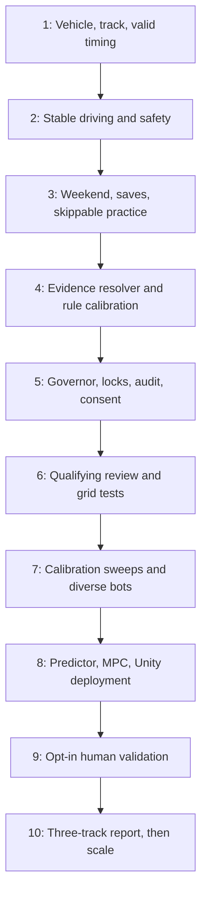

```text
RacingProject/
  Unity/Assets/Racing/
    Contracts/
    Vehicle/
    Track/
    Gameplay/
      Season/
      Weekend/
      Sessions/
    Policy/
    AI/
      Driving/
      Adaptation/
        Evidence/
        Profiles/
        Prediction/
        Planning/
        QualifyingReview/
      Inference/
    Integration/
    Telemetry/
    UI/
    Evaluation/
    Editor/
    Data/
    Models/Approved/
    Models/Manifests/
    Scenes/
    Tests/EditMode/
    Tests/PlayMode/
  Python/
    data_validation/
    features/
    calibration/
    training/
    evaluation/
    export/
    tests/
  Experiments/configs/
  Experiments/manifests/
  Docs/
```

Keep personal telemetry out of source control. Store dataset references and manifests instead.

### Completion gates

1. Play a valid weekend without learned AI.
2. Skip any/all practice and preserve correct progression and observations.
3. Produce safe recommendations with zero data or partial data.
4. Enforce competitive locks and audit all proposals.
5. Review qualifying without silently modifying the race challenge.
6. Demonstrate predictor and MPC benefits on held-out scenarios before promotion.
7. Report human fairness/transfer results and limitations honestly.
8. Expand tracks and grid only after calibration and runtime validation.

## Final architecture statement

Practice improves calibration but is never required. Qualifying supplies additional single-lap evidence but does not undo the competitive difficulty agreement. Unity owns correct rules, persistence, and enforcement; conventional control drives the cars; a hybrid predictive model and constrained planner recommend supported challenge settings. Sparse evidence produces uncertainty and conservative fallback, not hidden experimentation or manipulated race outcomes.
