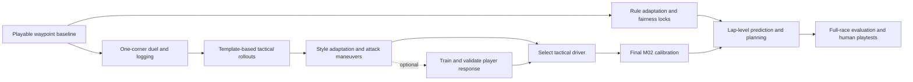

# Adaptive Racing Opponent — Implementation Sequence v1.2

This roadmap supersedes the order in the inherited checklist below. The core project remains playable without neural inference; tactical intelligence and challenge adaptation are separate experiments.



| Phase | Build | Exit gate |
|---|---|---|
| 0. Playable baseline | One track, shared Unity physics, valid timing, waypoint control, corner braking and recovery. Save scripted D04 as a selectable baseline. | Both cars can complete valid laps with no model. |
| 1. Test infrastructure | Build reproducible hairpin duels with matched initial states and normal-line, late-braking and switchback player bots. In parallel, build telemetry, rule adaptation, practice skips, qualifying review and competitive locks. | Duel replay shows actual inputs, maneuvers and outcomes; a complete weekend works with learned models disabled. |
| 2. Tactical world model | Add HoldLine, DefendInside and BackOut. Roll out candidate-conditioned player responses and vehicle motion; add a debug view, constraints and fallback. | Forecasts differ meaningfully between candidates. Invalid moves are rejected and a missing prediction cannot interrupt safe driving. |
| 3. Style and attacking | Update tendencies on completed encounters; add AttackInside, AttackOutside and Switchback individually. Require sufficient room and an abort for late inside attacks. | Same starting gap, difficulty and geometry produce different defensible decisions against distinct style histories. Overrides and contacts are logged. |
| 4. Optional learned response | Sample different legal executed AI maneuvers from comparable simulator starts; fit a compact model to predict player response probabilities. Hold out entire bot families or players, test probability calibration and run Python–Unity parity. | Deploy only if prediction and closed-loop tactics improve without safety regressions. Otherwise retain templates. |
| 5. Select driver and calibrate | Lock a tactical driver version for the experiment; run M02 pace sweeps with that driver and representative traffic. Validate M01 against the rolling pace baseline and test M01–M03 rollouts before connecting A06. | Calibration matches the shipped driver; fixed/rule/predictive comparisons use the same driver and respect the competitive lock. |
| 6. Expand and evaluate | Progress from one corner to one track, then full grid and broader circuits. Compare tactical variants separately from adaptation variants. Run opt-in human playtests. | Report clean passes and defenses, incidents, overrides, latency, fair-play feedback and pace calibration separately; distinguish simulated and human results. |

## First demo and acceptance checks

- Replay one hairpin with matching cars, starting gap and difficulty. Show HoldLine and DefendInside rollouts under a late-braker profile and a switchback-prone profile. A changed decision must follow from forecasted outcomes, not a direct style-to-maneuver rule.
- Compare scripted D04, non-interactive lookahead, and action-conditioned lookahead with matched scenarios and safety settings. If adding a learned model, compare against the template-based interactive model too.
- Test overlap, insufficient braking distance, surprise player moves, stale predictions, and third-car interference. Record proposed versus executed moves and verify that the safety override wins.
- Test no practice, sparse history, a strong qualifying result, and unexpected incidents. Competitive difficulty must remain locked while tactical maneuvers continue normally.
- Keep the original fixed-versus-rule-based comparison runnable throughout. The tactical experiment must not block completion of the assignment baseline.

---

## Inherited detailed engineering checklist

Use the checklist below for implementation specifics. Its original stage numbers and statements about scripted D04 or early M02 sweeps describe the v1.1 baseline, not the release order. For v1.2, do not finalize M02 calibration before selecting the tactical driver.

In your architecture, **"AI agents"** and **"world model"** are not one end-to-end neural network trained with RL. Before writing code, keep the division of labor from your spec clear, because it dictates the exact order in which components can be built and trained:

1. **AI Driving Agents (`D01–D08` in `Racing.AI.Driving`) are coded, not neural-trained.** They use conventional path following, backward-pass corner braking, tactical lane selection, and a safety filter.
2. **The World Model (`PredictiveRaceModel`: `M01–M03`) is a hybrid pace-and-gap dynamics model, not a pixel/physics simulator:**
   - `M02` (`CalibratedAIPaceModel`): empirical lookup/interpolation built from **automated Unity sweeps** of your `D01–D08` agents.
   - `M01` (`PlayerPacePredictor`): an ensemble of 3 compact PyTorch MLPs trained offline on **synthetic bot telemetry** (and later opted-in human telemetry) to predict clean player lap pace and variance.
   - `M03` (`AnalyticalTransitionModel`): deterministic mathematical gap propagation ($g_{t+1} = g_t + \hat{T}_{\text{player}, t+1} - \hat{T}_{\text{AI}, t+1}$).

Because `M02` measures how *your* `D01–D08` agents drive, and `M01` learns from *your* quality-gated telemetry (`O01/O02`) and baked track descriptors (`G16`), **you cannot train the world model until the driving agents, rules, and telemetry pipeline exist.**

---

## High-Level Sequence

```text
0. Playable Track, Physics & Timing (G15–G21, Contracts)
        │
        ▼
1. Code Conventional AI Driving Agents (D01–D08)
        │
        ▼
2. Code Telemetry, Policy Locks, Estimator & Rule Baseline (O01–O06, G12, A01–A02, A08–A11)
   + Early ONNX/Unity Inference Smoke Test (M04)
        │
        ▼
3. Run Unity Calibration Sweeps ──► Build M02 (CalibratedAIPaceModel)
   & Code Diverse PlayerBots (T01, T02) ──► Generate Synthetic Dataset (T03)
        │
        ▼
4. Train M01 (PlayerPacePredictor) & Validate M01+M02+M03 Rollouts in Python (T04–T07)
        │
        ▼
5. Integrate World Model + MPC Planner + Uncertainty Gate in Unity (A04–A07, M04–M05)
   & Benchmark Fixed vs Rule-Based vs MPC (T01, T06, T08)
        │
        ▼
6. Opt-In Human Playtests, Runtime Personalization (b_player,track) & Offline Re-Validation
```

---

## Step-by-Step Coding and Training Progression

### Stage 0: Prerequisite Track & Vehicle Spine (If not finished)
Before `D01–D08` can steer or measure anything, you need:
- **`Racing.Contracts`:** `VehicleCommand`, `VehicleObservation`, `SectorSummary`, `LapSummary`, `ChallengeContext`, `AdaptationProposal`, `ApprovedDifficultyConfig`, `IChallengePlanner`, `IFairnessGovernor`.
- **`Racing.Track` & `Racing.Vehicle` (`G15–G21`):** `TrackBakeTool` outputting `TrackRuntimeData` (centerline samples, curvature $\kappa$, widths, sectors, versioned $T_{\text{reference}}$), shared `VehicleSpecification` driving `VehicleMotor`, `VehicleSensors`, `TrackProgressService` ($p = nL + s$), `RaceTimingService`, and `SessionRulesService`.
- **Gate:** A human car can complete valid/invalid laps and sector crossings on your initial 3 tracks.

---

### Stage 1: Code the AI Driving Agents (`Racing.AI.Driving`, `D01–D08`)
*(Maps to Roadmap P2)*

Build and test the driving stack in this order:
1. **Single-car hotlapping (`D05` `PathFollower` + `D06` `PaceController`):**
   - `PathFollower`: speed-dependent look-ahead steering toward a valid lane path on `TrackRuntimeData`.
   - `PaceController`: curvature speed $v_{\text{corner}} = \min(v_{\max}, \sqrt{a_{\text{lat}} / \max(|\kappa|, \epsilon)})$ combined with a **backward braking pass** over upcoming samples so the car decelerates before corners.
   - Expose normalized pace/braking/acceleration scalars controlled by a single difficulty $d \in [0, 1]$ (strictly using the shared `VehicleSpecification`—never boost engine power or grip).
2. **Recovery (`D07` `RecoveryController`):**
   - Handle stuck, reversed, and off-track states via recovery commands or rule-authorized resets (`G14`).
3. **Multi-car interaction (`D04` `TacticalDriver` + `D08` `DrivingSafetyFilter`):**
   - `TacticalDriver` (lower-frequency tactical tick): choose follow/overtake/yield lane with hysteresis.
   - `DrivingSafetyFilter` (every physics tick): restrict raw commands from `D05/D06/D07` using track bounds (`G16`) and nearby closing speeds (`G19`) before writing `VehicleCommand` (`G17`).
4. **Identity & Mapping (`D02` `OpponentIdentity` + `D03` `PaceProfileMapper` + `D01` `AIDriver`):**
   - Compute $d_i = \operatorname{clamp}(d_{\text{session}} + \delta_i, 0, 1)$ with stable relative skill $\delta_i$ and style traits.

**Exit Gate:** 3–5 AI cars finish multi-lap races cleanly on all 3 tracks across $d \in [0.0, 1.0]$ with low incident rates and reliable recovery.

---

### Stage 2: Telemetry, Policy Locks, Estimator & Non-Neural Baseline
*(Maps to Roadmap P3–P5 — do this before ML training so your data schema, fairness invariants, and baseline exist first)*

1. **Observation & Telemetry (`Racing.Telemetry`, `Racing.Integration`):**
   - `O01` (`QualityGate` & `ObservationAggregator`): tag every sector/lap (`clean`, `traffic-limited`, `incident-affected`, `invalid`, `missing`), deduplicate sectors, keep raw times + versioned $T_{\text{reference}}$.
   - `O02` (`TelemetryRecorder`): buffered writer outputting `SectorSummary`, `LapSummary`, `DifficultyApplication`, `DecisionAuditRecord`, and `RunManifest`.
   - `O06` (`SnapshotBuilder` & `AIIntegrationBridge`): aligned-boundary snapshots for timing gaps.
2. **Weekend Lifecycle, Policy & Fairness (`Racing.Gameplay`, `Racing.Policy`):**
   - `G07–G14`, `A10` (`FairnessGovernor`), `A11` (`DifficultyConfigApplier`), `O05` (`DecisionAuditLog`).
   - Enforce competitive qualifying/race lock, stale proposal/session-version rejection, incident holds, cooldowns (provisional 2 player laps), step limits (provisional 0.02), and closing-race freeze (provisional final 2 laps).
3. **Non-Neural Profile & Rule Baseline (`A01`, `A02`, `A03`, `A08`):**
   - `A01` (`CalibrationEvidenceResolver`): handles practice skips and partial practice without error.
   - `A02` (`PlayerProfileEstimator`): clean-pace shrinkage estimator $\hat{s} = \frac{n_{\text{eff}}}{n_{\text{eff}} + k} s_{\text{recent}} + \frac{k}{n_{\text{eff}} + k} s_{\text{prior}}$, separating incidents from clean pace and single-lap qualifying (`A03`) from sustained pace.
   - `A08` (`ConservativeFallback`): rule-based baseline comparing clean estimated player pace vs calibrated AI pace between sessions.
4. **Inference Pipeline Smoke Test (`M04` + `T07`):**
   - Export a trivial dummy PyTorch MLP to ONNX and verify your pinned Unity inference package loads and matches Python outputs. Catch operator/opset limitations now before training real models.

**Exit Gate (Acceptance Gates 1–3):** A full weekend (including skipped practice) runs end-to-end with zero neural models, and all fairness/lock/stale-proposal/spin tests pass.

---

### Stage 3: Calibrate `M02` and Generate Synthetic Player Data (`T01–T03`)
*(Maps to Roadmap P6 — first empirical calibration & data generation phase)*

1. **Build `T01` (`EvaluationScenario` + `BatchSeasonRunner`):**
   - Automate headless/fast Unity runs with fixed timesteps, deterministic seeds, and `RunManifest` logging.
2. **Calibrate `M02` (`CalibratedAIPaceModel`):**
   - Run automated difficulty sweeps across:
     - All 3 tracks $\times$ dense difficulty grid ($0.0$ to $1.0$) $\times$ all `OpponentIdentity` profiles,
     - Both **clean-air** and **representative traffic** densities.
   - In Python (`T05`), build monotonic pace lookup/interpolation tables mapping `(track_descriptors, difficulty, identity, traffic_context)` $\to$ `(expected_AI_lap_time, empirical_variance, support_bounds)`.
   - Plug the calibrated curve back into `D03` (`PaceProfileMapper`) so difficulty scales map to known pace changes (do not assume linear difficulty = linear lap time).
3. **Code & Run `T02` (`Diverse PlayerBots`):**
   - Create **multiple distinct bot families** that vary: braking accuracy, cornering accuracy, throttle usage, lap-to-lap noise, correlated mistakes, within-weekend learning rate, pace drift, and traffic sensitivity.
   - Run `T01` + `T02` across tracks, skill sweeps, cold-start/skipped-practice patterns, and bounded difficulty variations to generate versioned `O02` telemetry (`T03` `Consented DatasetBuilder`).
   - Designate **entire bot families** (and optionally a track) as permanent holdouts.

**Exit Gate (Acceptance Gate 4):** Reproducible AI pace calibration tables (`M02`) and a provenance-labeled synthetic dataset (`T03`).

---

### Stage 4: Train & Validate the World Model (`M01` + `M03`) in Python (`T04–T07`)
*(Maps to Roadmap P7 — the ML training sequence)*

Inside your `Python/` stack, execute training in this exact progression:

1. **Leakage-Resistant Splitting (`T04` `GroupSplitter` & `FeaturePipeline`):**
   - Split strictly by **player/bot-family, full run/weekend, and track**. Never put adjacent laps from the same run in both train and validation/test sets.
   - Fit feature clipping and normalization constants **only on the training split** and serialize them into `ModelManifest` (`M05`).
2. **Train `M01` (`PlayerPacePredictor` Ensemble) — Stage A (1-Step Prediction):**
   - **Inputs:** masked history of the last 3–5 valid lap/sector observations (with validity/missingness/prediction masks and age), normalized clean pace, trend, variation, track descriptors, familiarity, personalization correction (zeroed for base synthetic training), and supported traffic context.
   - **Model:** 3 independently initialized MLPs (starting size: 2 hidden layers $\times$ ~64 units each), trained on bootstrap samples of whole runs/players, predicting `(expected_clean_lap_time, predictive_variance)`.
   - **Data augmentation for cold starts:** Randomly mask early/practice history rows during training so the model learns realistic uncertainty when practice is skipped or partial.
3. **Evaluate Multi-Step Rollouts with `M02 + M03` — Stage B ($H = 3$ Horizon):**
   - Do **not** only check 1-step error. Roll out $H = 3$ steps using `M01`, `M02`, and `M03`:
     - Update cumulative gap: $g_{t+1} = g_t + \hat{T}_{\text{player}, t+1} - \hat{T}_{\text{AI}, t+1}$.
     - Append $\hat{T}_{\text{player}}$ into the history window marked with a **predicted-value mask** (do **not** increment real evidence count $n_{\text{eff}}$).
     - Propagate uncertainty across the 3 ensemble trajectories rather than resetting it at each step.
   - Verify multi-step error, ensemble disagreement, and uncertainty interval coverage on held-out bot families and tracks.
4. **Compare Against Non-Neural Baseline — Stage C:**
   - Benchmark `M01` against your rolling clean-pace estimator (`A02`/`A08`). If `M01` does not outperform or match it cleanly with calibrated uncertainty, adjust features/regularization before deploying.
5. **Export & Parity Check (`T07` + `T06`):**
   - Export the 3 MLPs to ONNX with `ModelManifest` (`M05`).
   - Run automated `ONNXExport and UnityParityTests` (`T07`): pass identical test batches to PyTorch and Unity (`M04`) and verify outputs match within numerical tolerance.

**Exit Gate (Acceptance Gate 5):** Candidate passes `T06` (`Validation and ReleaseGate`) for 1-step & 3-step accuracy, uncertainty coverage, OOD rejection, ONNX parity, and CPU latency budget.

---

### Stage 5: Integrate World Model, MPC Planner & Uncertainty Gate (`A04–A09`, `M04–M05`)
*(Maps to Roadmap P8)*

1. **Runtime Inference (`M05` + `M04`):** Load the approved `ModelManifest`, apply identical normalization to `T04`, and run bounded inference jobs with a strict deadline (any timeout, missing manifest, or NaN falls back to holding the active setting).
2. **Forecast Context & Support Gate (`A04` + `A07`):**
   - `ForecastContextBuilder` (`A04`): align matched timing boundaries from `O06` (flag gap unavailable if unaligned).
   - `Support and UncertaintyGate` (`A07`): combine ensemble disagreement (`M01`), feature/calibration support checks (`M02`/`M05`), and recent residual/qualifying diagnostics (`A03`). On failure, route to `A08` (`ConservativeFallback`).
3. **MPC Planner (`A05` + `A06`):**
   - **Between sessions:** `CandidateGenerator` (`A05`) searches a coarse grid (e.g., $0.0\text{–}1.0$ in $0.1$ steps + local refinement) as fixed settings for the upcoming block.
   - **Opt-in live training mode:** `A05` searches policy-feasible sequences (`current - step`, `current`, `current + step`) respecting the 2-lap cooldown and closing-race freeze ($\le 27$ sequences over $H=3$ before pruning).
   - `MPCChallengePlanner` (`A06`) scores trajectories over $H \le 3$ via:
     $$J = \sum_{h=1}^{H} \left[ w_p\,\operatorname{dist}(\hat{T}_{\text{AI},h} - \hat{T}_{\text{player},h}, \mathcal{B}_{\text{pace}})^2 + w_d(d_h - d_{h-1})^2 + w_u U_h \right]$$
     and submits `AdaptationProposal` (`A09`) $\to$ `FairnessGovernor` (`A10`) $\to$ `DifficultyConfigApplier` (`A11`).
4. **Automated Simulation Benchmark (`T01` + `T06` + `T08`):**
   - Run paired comparisons (**Fixed** vs **Rule-Based `A08`** vs **Predictive + MPC**) across Competitive and Live Training modes, including all failure scenarios (no practice, skipped practice, single spin, overtake, large lead, dense traffic, unseen bot family).

**Exit Gate (Acceptance Gate 6):** MPC improves pace-band matching and stability over Fixed and Rule-Based baselines with **zero** policy/fairness violations and zero safety regressions.

---

### Stage 6: Human Evaluation, Runtime Personalization & Offline Re-Training
*(Maps to Roadmap P9–P10)*

1. **Zero-Shot + Runtime Personalization First:**
   - Do **not** retrain neural weights during live play.
   - Collect opt-in human sessions (`G05` consent) using the synthetic-trained `M01` + `M02` + runtime additive pace correction in `A02`/`O04`:
     $$\hat{T}_{\text{human}} = \hat{T}_{\text{base}} + b_{\text{player, track}}$$
     shrinking $b_{\text{player, track}}$ toward a global $b_{\text{player}}$ when track data is scarce.
2. **Careful Offline Human Adaptation (`T03–T07`):**
   - Partition consented pseudonymous human logs (`T03`) by **player**, keeping a **strictly held-out human test partition** (`T04`).
   - Only if held-out metrics show benefit over the additive correction alone, fine-tune `M01` or fit a compact residual offline (`T05`), pass `T06` ReleaseGate + `T07` ParityTests, and deploy through `M05`. If human transfer of `M01` underperforms the transparent rolling pace estimator, fall back to the rolling estimator.
3. **Evaluation Report (`T08`):**
   - Report human fairness/enjoyment ratings separately from bot pace-closeness metrics, and document cold-start performance across 0, 1–3, and >3 clean laps.

---

## Immediate Next Actions to Start Coding Today

1. Verify `Racing.Contracts` and `G15–G21` (track bake + shared motor + valid lap/sector timing) work on 1 circuit.
2. Implement `D05` (`PathFollower`) + `D06` (`PaceController` with backward braking pass) + `D07` (`RecoveryController`) so one AI car laps cleanly.
3. Add `D04` (`TacticalDriver`) + `D08` (`DrivingSafetyFilter`) + `D02/D03` (`OpponentIdentity`, `PaceProfileMapper`) for 3–5 car racing.
4. Wire `O01/O02` (`QualityGate`, `TelemetryRecorder`), `G12/A10/A11` (`FairnessGovernor` + locks), and `A01/A02/A08` (non-neural rule baseline) + a 1-layer ONNX dummy parity test in `M04`. Once those pass, launch your first automated sweeps (`T01`) to build `M02` and `T02` bot datasets.